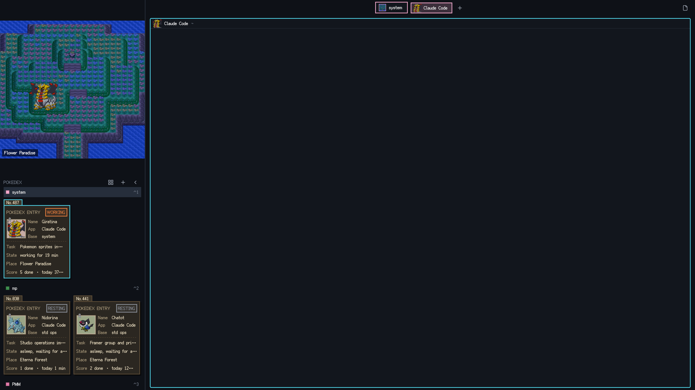
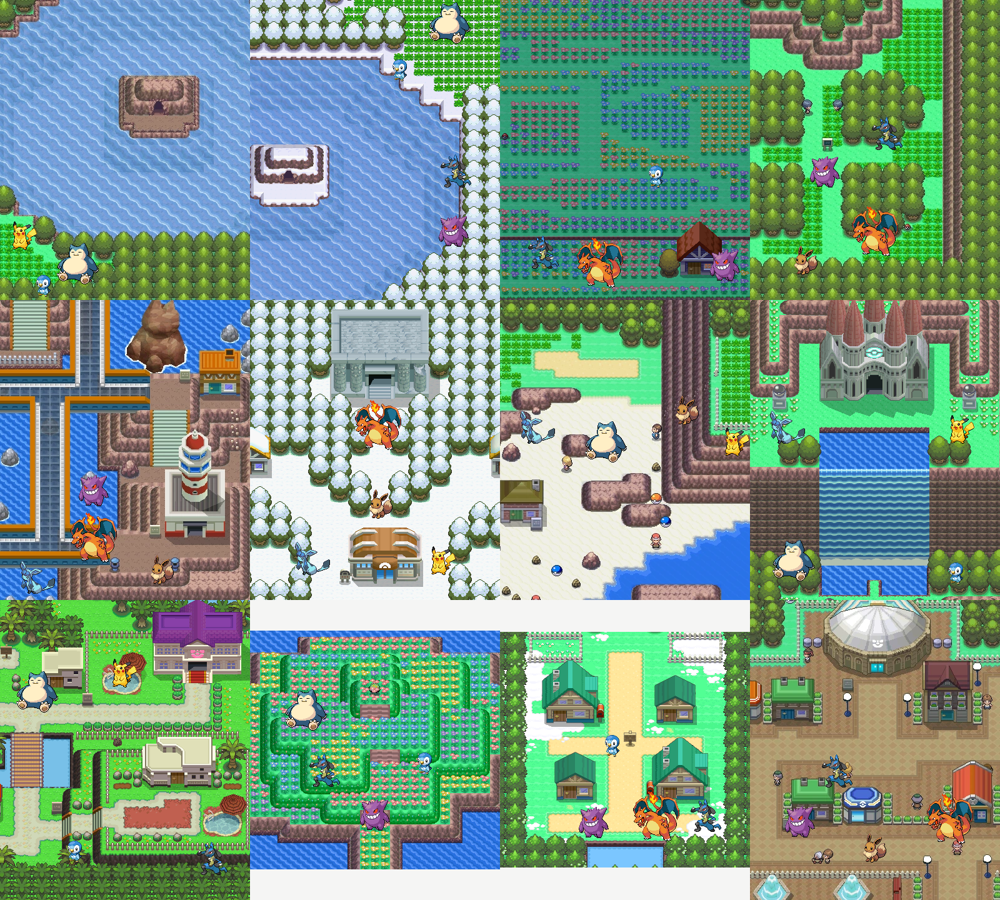

# Pokémon Sinnoh · a layout for the Herdr app



A [Herdr](https://herdr.dev) desktop layout in the look of Pokémon Platinum, built on top of **[Kaiju City](https://github.com/Jiqize/herdr-kaiju) by [Jiqize](https://github.com/Jiqize)**, who made the original layout, its sidebar, dossier cards and news card. This is a reskin of that work; the Pokémon parts are the only new thing. The sidebar shows the current space as one of twelve Sinnoh locations, cut from the real DS overworld maps, with the space's agents standing in it as Pokémon drawn with their Platinum sprites. Every space gets a random place and every agent a random Pokémon out of all 493. Working Pokémon hum with music notes, done ones cheer with sparkles, blocked ones wave a "?", resting ones nap. The Pokédex below lists the agents as dossier cards with their Dex number, task, place and score, and a news card announces finished work as "Bidoof used Tackle! Defeated: fix the login bug".



## Install

Needs the Herdr desktop app (built and checked with 0.1.13 on macOS) and the `python3` that ships with macOS. No Python packages: all the art is in the repo, ready made.

```sh
git clone https://github.com/nick-datalane/herdr-sinnoh.git
cd herdr-sinnoh
./install.sh
herdr-app do layout.switch '{"name":"pokemon"}'
```

`install.sh` copies only this layout's own files into `~/.config/herdr-app/` (it respects `HERDR_APP_HOME`): `layouts/pokemon.json` + `.svg`, `themes/pokemon.json` + `pokemon-night.json` and `mods/pokemon/`. It merges one key, `cmd-b` → collapse the sidebar while this layout is shown, into `keys.json`, asks before replacing a `cmd-b` you already bound in this layout's section, and backs `keys.json` up first. The chrome and the cards follow the system's light or dark mode; the scenes and the Pokémon are always in daylight.

## Keys

| Key | Action |
|---|---|
| `cmd-b` | collapse / expand the sidebar |
| `ctrl-1…9` | go to space N |
| `cmd-1…9` | go to tab N |
| `ctrl-shift-l` | switch layout |
| click a Pokémon or a card | focus that agent's pane |
| click the space capsule | rename the space |

## What you get

- **Twelve places**, random per space: Lake Verity, Lake Acuity, Floaroma Meadow, Eterna Forest, Sunyshore City, Snowpoint City, Valor Lakefront, the Pokémon League, the Resort Area, Flower Paradise, Twinleaf Town and Hearthome City. A space keeps its place until it closes.
- **All 493 Pokémon**, random per agent, with their Platinum battle sprites. An agent keeps its Pokémon until it goes away.
- **Status without noise**: working = music notes, done = sparkles and "!!", blocked = "?", resting = "zz". Nothing shakes.
- **Pokédex cards** (or small photos: the toggle in the header) with the Dex number, the app, the tab, the task, a timer, the place and a score.
- **Battle-line news** for agents finishing in the background: "Giratina used Shadow Force! Defeated: migrate the schema". Click it to jump there.

## Uninstall

Switch to another layout (`ctrl-shift-l`), then delete `layouts/pokemon.json`, `layouts/pokemon.svg`, `themes/pokemon.json`, `themes/pokemon-night.json` and `mods/pokemon/` from `~/.config/herdr-app/`, and the `layout:pokemon` section from `keys.json`.

## Changing the art (optional)

The build lives in `art/` and needs Pillow and numpy (`pip3 install pillow numpy`).

- Places: `art/places.json` lists each place's map (`art/maps-gen4/`), the 400×480 window to show and the spots where Pokémon stand. Add or remove entries.
- Pokémon: `art/roster.json` lists who can appear; delete lines to shrink the pool to favourites.
- Then `python3 art/build_assets.py`, look at `art/samples/assets-check.png`, and run `./install.sh` again.

[RECIPE.md](RECIPE.md) is the full brief: what every part shows, how it behaves and what it is built from.

## Credits

- Started from Jiqize's [Kaiju City](https://github.com/Jiqize/herdr-kaiju) layout (MIT), whose structure, Pokédex cards and news card this keeps.
- Pixel font: [Fusion Pixel Font](https://github.com/TakWolf/fusion-pixel-font), SIL OFL 1.1.
- Pokémon sprites, names and move data from [PokeAPI](https://github.com/PokeAPI/sprites); location maps from the Pokémon Fandom wiki. Pokémon is © Nintendo / Creatures Inc. / GAME FREAK inc. This is a fan-made skin for personal use; the code is MIT, the game art is not.
