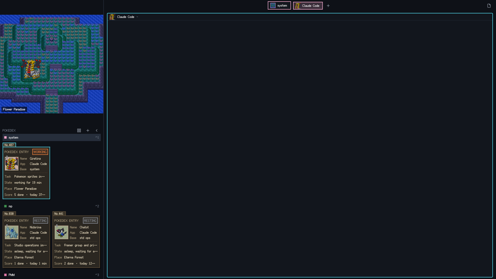

# Pokémon Sinnoh

A Herdr window in the look of Pokémon Platinum. The top of the left sidebar is a scene: the current space's Sinnoh location, drawn with the real DS overworld map, and the space's agents standing in it as Pokémon drawn with their Platinum battle sprites. Every space gets a random location out of twelve of Sinnoh's prettiest places; every agent gets a random Pokémon out of all 493. Below the scene the Pokédex lists the agents as dossier cards or small photos. The top bar and the pane headers show the Pokémon's faces, and a news card pops up like a battle message when a background agent finishes. The scenes and the Pokémon are always in daylight; only the chrome and the cards follow light or dark mode. All text uses the Fusion Pixel 12 px font.

## What you see

Left to right, top to bottom:

- **Sidebar** (400 px, `chrome` background, not resizable, 2 px `border` divider).
- **Scene** (top of the sidebar, 492 px tall, drags the window): a 400×480 canvas 8 px from the top. It shows the current space's location: a window of at most 400×480 cut from a Pokémon Platinum overworld map at 1 map pixel = 1 logical pixel (smaller maps sit centred on the `chrome` background). A caption chip at the bottom-left names the place. The twelve places and their accent colours: Lake Verity `#5b8fd6`, Lake Acuity `#9fc4e6`, Floaroma Meadow `#e07aa8`, Eterna Forest `#3f8f4f`, Sunyshore City `#f0a030`, Snowpoint City `#a9c4d8`, Valor Lakefront `#e8d49a`, Pokémon League `#8b6fc9`, Resort Area `#5fb86f`, Flower Paradise `#f3a6c9`, Twinleaf Town `#6fb9a0`, Hearthome City `#c98c5a`.
- **Pokémon**: the current space's agents stand on the place's 4 stands, in order of appearance: hand-picked spots on walkable ground, kept toward the middle of the scene (never in a corner) and at least a sprite apart (85 px sideways or 80 px vertically), so Pokémon never overlap. Past the last stand they repeat the stands 30 px right and 20 px down. Each is its Platinum front sprite (80×80 DS pixel art, 1 art px = 1 logical px), lower feet drawn in front. Resting agents have a big Z and a small z (`fx/z1`, `fx/z2`) drifting up and fading over the head on slow loops (2.6 s and 3.2 s), done ones sparkles and a "!!", blocked ones a "?", and working ones three music notes (pink, blue, yellow) drifting over the head. Nothing shakes.
- **Pokédex** (below the scene): a "POKEDEX" header with a mode toggle, + (new space) and ‹ (collapse). Then, per space, a 28 px row (a 10 px square in the place's colour, the name, `⌃N` for the first nine; the current space has the `selected` background), followed by its agents:
  - **Card mode** (default), two per row, 184 px wide: a kraft-paper card (`#f3e7c9`, dark brown `#2b2721` at night) with a folder tab "No.025" (the National Dex number), a hard 3 px shadow, "POKEDEX ENTRY" and a status stamp (RESTING gray, WORKING orange, DONE red, NEEDS YOU yellow), a paper-clipped photo with a 48 px face crop of the sprite (a music note pinned in the corner while working), the fields Name, App, Base (tab name, or the space name), a dashed rule, then Task (terminal title with the program and space names removed; "none" when empty), State (timer such as "working for 3 min" / "waiting 2 min" / "finished 5 min ago", or a quip), Place (the space's location) and Score ("3 done · today 1h 5m").
  - **Photo mode**: one 56 px tile per agent (48 px face in a photo frame, border in the status colour), six per row. Details in the tooltip.
- **Collapsed sidebar** (76 px, scene hidden): one 48 px tile per space with a 30 px chip of its place (a smooth-scaled square of the scene, 1 px border in the place colour) and an 8 px status light (working pulses). On macOS it leaves 50 px at the top for the traffic lights. At the bottom: +, settings and ›.
- **Top bar** (44 px, `canvas`, drags the window). Centred: a 32 px space capsule (2 px border in the place colour, a 20 px place chip, the name, a 2 px hard shadow), then the tab pills (30 px, 2 px border, a 24 px face of the tab's first agent, or a brick when it has none). The current tab is filled with the place colour mixed 80 % toward `chrome`. A blocked tab ends in a 6 px yellow square. Then a + button. On the far right: 30 px Files and Changes toggles.
- **Work area**: padding [6, 12], gap 10. Every pane is a card with radius 4 and a 2 px `border` (`input` when focused). Its 28 px header holds a 24 px face (or a brick), the program name (or terminal title), and the folder in `dim` (home shown as `~`). Blocked panes get a yellow "Needs you" tag.
- **Side panel** (hidden, 368 px): Herdr's Files and Changes.
- **News card** (floating, right edge, bottom; Herdr draws the frame): 286 px wide, a 3 px red strip, a "POKEDEX NEWS" header with ×, and up to 3 rows of 48 px: a 32 px face, then two lines. Done: "Bidoof used Tackle!" over "Defeated: <task>" (the space name when there is no task). Blocked: "Bidoof needs you!" over "<space> · <task>". Blocked rows end in a 6 px yellow square. "N more" follows when there are more.

**Themes**: `pokemon` (light) has canvas/chrome `#f5f5f4`, surface `#fbfbfa`, selected `#e2dfda`, border `#dedbd5`, input `#2b2620`, accent `#e07a3c`. `pokemon-night` (dark) has canvas/chrome `#0e1117`, background `#12161d`, selected `#262e3b`, border `#232a35`, input `#4fd1e5`, accent `#ffd877`. The art never changes with the theme: scenes, Pokémon, faces and effects are the same daylight files in both modes (`assets/day/` is the only set).

## How it behaves

- **Space → place**: a space gets a random place the first time it is seen, avoiding places other spaces have while any are free (12 places, so the first 12 spaces are all different). Kept in shared `pokemon.places`; a space keeps its place until it closes. Switching spaces swaps the scene.
- **Agent → Pokémon**: likewise, from all 493, shared `pokemon.monsters`.
- **Status → Pokémon**: idle: sprite + two Zs on native `loop`s (top 0 → −10/−8 px, opacity 1 → 0.15, periods 2600/3200 ms). working: sprite, three notes on native `loop`s (top 0 → −8/−10/−7 px, opacity 1 → 0.35, periods 1500/1900/1700 ms). done: the sprite with sparkles + "!!". blocked: sprite + "?". Stand changes slide over 500 ms.
- **Clicks**: a Pokémon, a card or a tile focuses the agent's pane. Right-click a space row or rail tile for Herdr's space menu.
- **Pokédex**: the mode toggle switches card/photo mode and is remembered (`pokemon.roster`). Timers refresh at the next whole minute, only while some agent is working. The score counts one "done" per finished round of work (working → done or idle) and today's working time, reset at midnight (`pokemon.stats`).
- **Collapse**: ‹ / › or `cmd-b` in this layout hides the scene and resizes `sidebar` between 400 and 76 px.
- **Top bar**: click the capsule to rename the space. Click a tab to select it, double-click to rename, drag onto another to reorder, right-click for Herdr's tab menu. The wheel over the bar switches tabs.
- **News**: an agent joins the card when its status changes to done or blocked while it isn't focused, and Herdr's own toast for that event is retracted so the card is the only alert. Agents seen for the first time don't count. Newest on top, one row per agent; the face drops in with a spring. Clicking a row focuses that pane and removes the row. A row also leaves when its agent gets focus, its status moves on, or the agent goes away. × clears the card; an empty card draws nothing.
- **Light/dark** follows the system (or `appearance` in settings.json) for the chrome and the cards; the scene stays daylight.

## Built from

- The structure, the Pokédex cards, the news card, the top bar and the pane headers come from Jiqize's Kaiju City layout (github.com/Jiqize/herdr-kaiju, MIT). This recipe describes the Pokémon reskin of it.
- `layouts/pokemon.json`: the root `row` (titlebar none, traffic_lights [16, 18], theme `{light: "pokemon", dark: "pokemon-night"}`, ui_font `Fusion Pixel 12px Prop zh-Hans`, terminal_padding [12, 10], 2 px `border` dividers) holds a `sidebar` column (px 400, `chrome`) with `city` (px 492, `window_drag`, part `city`) and `roster` (part `roster`), and a `work` column with `tabs` (px 44, part `top`) and the `main` tab block (pane header `{mod: "pokemon"}`, height 28) beside the hidden `panel`. Root `floating`: the `news` part on the right edge, aligned end.
- `mods/pokemon/`: `main.js` dispatches on `props()`: `pane` → `pane.js`; part `city` → `city.js` (the scene), `roster` → `roster.js`, `top` → `top.js`, `news` → `news.js`. `state.js`: night detection, asset paths, the random Pokémon per agent (`assign`, `monsterOf`), the random place per space (`assignPlaces`, `placeOf`, `placeFor`).
- `mods/pokemon/assets/day/`: `places/<id>.png` (the scene, 2×) and `places/<id>-thumb.png` (64×64), `monsters/<id>/` (`idle.png`, `roar.png` in the uniform sprite box, `head.png` 48×48 at 1×, `avatar.png` 48×48 at 2×, `face.png` 32×32 at 2×), `fx/` (bang, question, z1, z2, siren, brick, note1–3, clip). `manifest.json` / `manifest.js`: canvas, places (name, colour, size, stands), the sprite box, `files` (which file each pose uses), the 493 monsters (id, name, dex, move, top), effect sizes.
- `art/`: `places.json` (id, name, colour, map file, crop, stands) and `maps-gen4/` (the DS maps, from the Pokémon Fandom wiki; `raw/` keeps rips that needed fixing, and `daylight.py` turns the wiki's dusk-tinted Floaroma Meadow rip back into daylight by fitting a per-channel gain/offset against a daytime Diamond/Pearl screenshot of the same tiles), `roster.json` (all 493), `sprites-gen4/` (Platinum and Diamond/Pearl sprites and `names.json` from PokeAPI, `moves.json` built from PokeAPI's Platinum level-up data: the strongest same-type damaging move, with hand-picked signature moves for the famous ones), `gen4.py` (frames and face crops), `build_assets.py` (builds everything and writes `art/samples/assets-check.png`, every scene with Pokémon on its stands, and `assets-faces.png`). `pokemon.py` (code-drawn chibis) and `pixelize.py` remain usable through `"gen"` / `"sheet"` roster entries.
- `mods/pokemon/fonts/`: Fusion Pixel 12 px proportional (zh_hans), OFL. `keys.json`: `{"layout:pokemon": {"cmd-b": "pokemon.toggle"}}`.
- Shared state: `pokemon.monsters`, `pokemon.places`, `pokemon.stats`, `pokemon.roster`.
- `herdr` functions used: `spaces`, `panes`, `agents`, `setAgentOrder`, `run`, `openOverlay`, `props`, `theme`, `window`, `shared`, `setShared`, `layout`, `nextCommand`, `home`. Commands: `space.select/new/rename`, `tab.select/rename/move/prev/next`, `pane.focus/split/zoom/close`, `layout.resize/show/hide/select`, `app.settings`.
- It runs no programs and makes no network calls (the art was downloaded once, at build time).

### Changing the places or the Pokémon

- Places: edit `art/places.json` (add a map to `art/maps-gen4/`, choose a crop of at most 400×480 and 4 stands in crop coordinates on walkable ground near the middle, 85 px apart sideways or 80 px vertically), run `python3 art/build_assets.py` (needs Pillow and numpy; no `-I` on this Mac), check `art/samples/assets-check.png`, then copy `mods/pokemon/assets/` and `manifest.js` into `~/.config/herdr-app/mods/pokemon/`.
- Pokémon: `art/roster.json`; delete lines to shrink the pool. Entries are `{"id","name","dex"}` (a Platinum sprite), `{"id","name","gen"}` (a chibi from `art/pokemon.py`) or `{"id","name","sheet"}` (an AI sprite sheet).

## Watch out

- A pane header copy only gets `{pane, terminal}` as props, so it is detected by `props().pane`, not by `part`.
- Only the `roster` copy listens to `nextCommand()`.
- Herdr's "done" only clears when you actually look at the agent; `pane.focus` from a command doesn't clear it.
- The random picks are made by whichever part renders first and written to shared state at once; all parts read the same map on the next frame.
- There is no repeating timer; notes and lights are native `loop`s. With nothing changing, the mod doesn't redraw.
- A floating block doesn't re-render when agents change (only on focus, layout and shared-state changes), so on its own the news card misses most working → done steps. The roster, which does re-render, calls `pulse(list)` (state.js) on every render: it writes the agents' status signature to shared `pokemon.pulse` when it changed, and a shared-state change re-renders every copy, the float included.
- `notify()` and `writeTextFile()` called from a layout-owned copy's render are unreliable; `setShared` always works, and shared.json on disk shows it, which makes it the dependable debug channel.
- The floating news frame is drawn by Herdr; the mod draws only the content. Herdr posts its own toast for the same event, and a layout can't swap the shipped `toast` mod, so the news part retracts it: a probe `notify()` closed at once reveals the sequential overlay counter (`o46`), `exec("herdr-app", ["status"])` lists the open overlays by mod name, and when only toasts are open the ids just below the probe are closed (an id that isn't live is a no-op). It runs at once and again 450 ms later, because Herdr can post the toast after the status change reaches the mod.
- Some wiki map rips were captured at dusk, with Platinum's blue evening tint baked into the pixels (Floaroma Meadow was one). Check a new map's grass against the others (daytime grass is around `#50f888` / `#28c868`) and run it through `art/daylight.py` with a daytime reference if it looks dark.
- The font file is 7 MB. Themes must be in `themes/`.
- Built and checked on macOS with Herdr 0.1.13.

## Done when

- `herdr-app check ~/.config/herdr-app/mods/pokemon` passes, and `herdr-app status` lists no pokemon errors.
- `layout.switch {name: "pokemon"}` shows the current space's Sinnoh scene with its caption, the Pokédex, the top bar and the pane headers in the pixel font. Each space has a different place while fewer than 12 are open.
- A working agent's Pokémon stands still with three floating notes; blocked shows "?"; done shows sparkles and "!!"; idle shows two slowly drifting Zs.
- The Pokédex mode toggle switches between cards and photos and stays after a restart. Cards show the Dex number and the place.
- `cmd-b` collapses the sidebar to 76 px and back.
- When an agent in a background tab finishes, the news card says "<Pokémon> used <move>!" / "Defeated: <task>", and clicking it jumps to that agent.
- With `"appearance": "dark"` in settings.json, the chrome and cards go dark while the scene stays in daylight.
